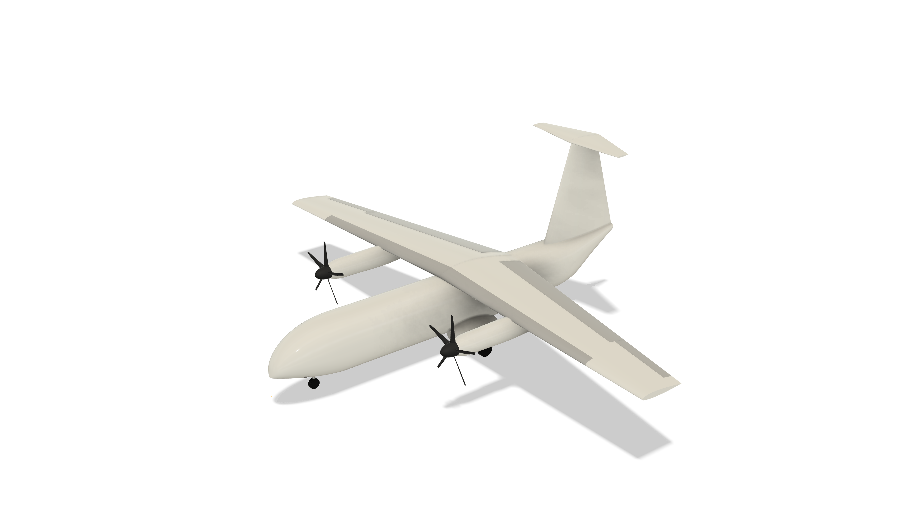
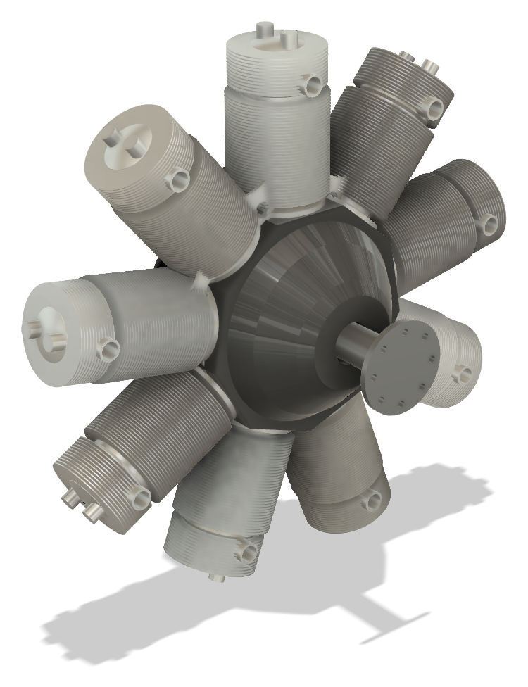
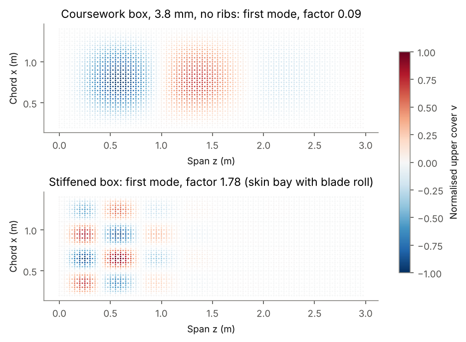

# Engineering portfolio

Great Olu-Osagie, BEng Aeronautical Engineering, University of Glasgow.

Five design and analysis projects, modelled in Autodesk Fusion and checked by independent methods: hand calculation against finite element analysis, CAD geometry against the numbers it was built from, mechanism motion against closed-form kinematics. Each project states its limitations, and several report where a design does not work.

Every project folder holds its Fusion source file (`.f3d`), a README with the key results, and the design notes and decision log.

## Projects

### AC-01: IATS hydrogen-electric STOL aircraft

A 12-passenger hydrogen-electric aircraft for the Scottish Hebrides, from a six-person design project where sizing and stability were my workstream. The Fusion model checks the team's numbers against the geometry they imply. It found that the quoted 10.15 % static margin rests on two errors that act in opposite directions (the wrong mean chord and a tail arm 20 % shorter than assumed), that the stated CG cannot be reproduced from the report's own mass table, and that the main gear position fails the tip-back check. General arrangement drawing, STEP export and design notes included.

[Project folder](AC-01/iats-cad) · [General arrangement (PDF)](AC-01/iats-cad/outputs/AC-01-GA-001.pdf)

### VT-01 Aero OML: VTOL wing aerodynamics and outer surface

Main wing for a 4 kg twin-boom VTOL: 2.0 m span, SD7062 aerofoil chosen from a trade of seven sections, 2° washout outboard of the boom so the root stalls first. Sized from requirements, then checked with a vortex lattice model (span efficiency 0.984).

[Project folder](VT-01%20Aero%20OML/vtol-wing-aero)

### VT-01 Structure: VTOL wing spars, ribs and FEA

CFRP spar and rib structure for the same wing, with loads taken from the aerodynamic model. The beam prediction was written down before the Fusion FEA was solved: tip deflection agrees to 0.4 %. Half-wing primary structure 173 g.

[Project folder](VT-01%20Structure/vtol-wing-structure)

### R9: nine-cylinder radial crank train

A 27 L single-row radial modelled as a working mechanism. Individually tuned knuckle pins bring the spread in top dead centre height between cylinders from 2.40 mm to under 0.001 mm. The assembly matches the closed-form kinematics to 0.00012 mm across 657 piston positions, with no contact between 79 part pairs over a full revolution.

[Project folder](R9/r9-radial)

### WB-01: wing box verification and redesign

A re-check of my own wing box coursework. Thin-wall beam theory matches shell and solid FE to within 2 %, but the coursework design buckles at 4 to 9 % of its design load. The stiffened redesign (5.2 mm skin, three blade stringers per cover) survives 1.5 times the load without buckling, at 612 N/m.

[Project folder](WB-01/wingbox-verification)

## Tools

Autodesk Fusion (modelling, assemblies, static stress), CalculiX, Python (NumPy, SciPy, Matplotlib, AeroSandbox and NeuralFoil), BS 8888 drawing practice.
