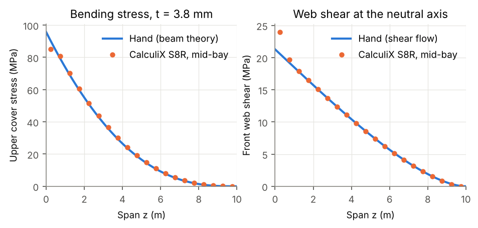
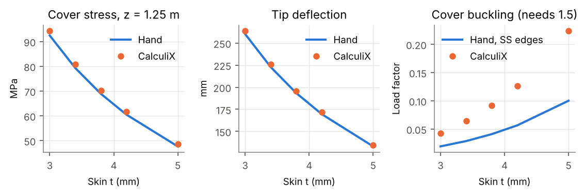
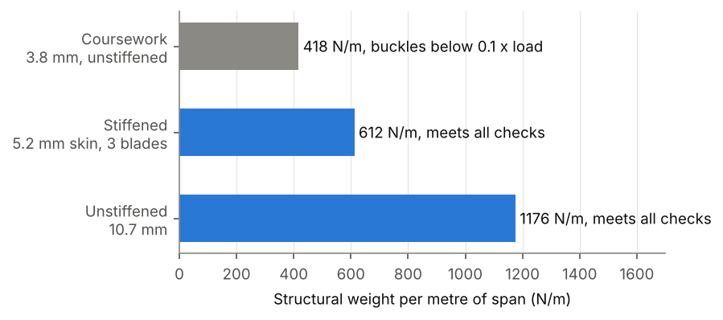

# WB-01 Wing box verification report

ENG3081 wing box, re-checked by finite element analysis and redesigned for buckling.

## 1. What this is

The ENG3081 coursework sized a 10 m semi-span wing box by thin-wall beam theory. It picked a uniform 3.8 mm wall, which keeps the root bending stress under 100 MPa and the web shear under 50 MPa, at 417.5 N/m. This work asks three questions:

1. Does the hand method give the right stresses, deflection and twist? Checked against two independent finite element models in CalculiX, and set up in Fusion.
2. What did the coursework leave out? Buckling.
3. What does a box that does not buckle actually weigh?

Every number here comes from a file in this repository. Section 8 lists them.

## 2. Inputs

As in the coursework brief: 10 m semi-span, 2 m chord, box 1.2 x 0.2 m on the wall midlines with the front web 0.2 m from the leading edge, elliptical lift with 3500 N/m at the root, centre of pressure 0.4 m from the leading edge, density 4000 kg/m3, allowables 100 MPa direct and 50 MPa shear.

The brief gives no stiffness. E = 110 GPa, ν = 0.33 (titanium-like) was chosen because it is the closest common alloy to the 4000 kg/m3 density. Stresses do not depend on E; deflection, twist and buckling do.

Axes: x chordwise from the leading edge, y up, z spanwise from the root.

## 3. Hand calculation

`hand_calc/wingbox_hand.py` is a Python port of the coursework spreadsheet. It reproduces all 71 rows: weight to 0.06 N, bending stress to 0.005 MPa, total shear to 0.0006 MPa. The pytest suite checks this. The port turned up three slips in the written report (the spreadsheet is right in each case):

| Item | Report | Correct |
|---|---|---|
| Total shear at 3 mm (Table 2) | 25.9 MPa | 27.8 MPa |
| Direct web shear at 3.8 mm | 15.38 MPa | 15.34 MPa |
| Torsional shear at 3.8 mm | 6.02 MPa | 6.03 MPa |

None of them changes the 3.8 mm result.

Added to the coursework method: a full open-section shear flow solution round the box (peak web shear 21.77 MPa against the coursework's average-web 21.37 MPa), tip deflection by integrating the curvature, Bredt-Batho tip twist, and plate buckling of the covers and webs.

## 4. Finite element models

| Model | File | Elements | Purpose |
|---|---|---|---|
| Shell | `calculix/wingbox_shell.py` | S8R, 50 mm, averaged corner normals, optional rib diaphragms | Main comparison, sweep |
| Solid | `calculix/wingbox_solid.py` | C3D20R, one brick through the wall | Settles the corner modelling question; closest to Fusion |
| Stiffened solid | `calculix/wingbox_stiffened.py` | C3D20R extruded from a quad8 section mesh, ribs as in-plane rigid diaphragms | Checks the redesign |
| Fusion | `docs/fusion_study_setup.md` | Parabolic tetrahedra | Commercial-code check (further work) |

Common to all of them: root fully fixed, and gravity on the material. The lift goes in as nodal forces on the two webs, 5/6 to the front web and 1/6 to the rear, so the resultant lies on the centre of pressure line. Each span row gets the exact lift over its tributary length. The applied root reaction is 23,321 N against the 23,314 N expected.

Loading the webs rather than the cover is deliberate. A pressure on an unstiffened 1.2 m cover would bend the plate locally, and the beam model has nothing to compare that with.

Two solver issues were found and dealt with:

- CalculiX turns shell nodes where walls meet at an angle into rigid knots. At the box corners this changed the first buckling factor from 0.093 to 0.075. Giving the corner nodes one averaged normal removes the knots; the solid model, which has no knots, agrees with the averaged-normal shells.
- At the full design load, `*BUCKLE` returned factors clustered near 1 that did not change when the load was scaled. Buckling runs therefore use a reference load of 1 % of the design load, and the factors are rescaled. A cantilever strip test with this method gives 2294 N against 2262 N from Euler (1.4 %).

## 5. Verification at the coursework design, t = 3.8 mm

### 5.1 Stress, deflection and twist

| Quantity | Hand | CalculiX shells, ribs every 0.5 m | Difference | CalculiX shells, no ribs | Difference |
|---|---|---|---|---|---|
| Cover stress, mid-chord (MPa) | 68.89 at z = 1.25 m | 70.28 | +2.0 % | 78.18 vs 76.89 at z = 1.0 m | +1.7 % |
| Front web shear, neutral axis (MPa) | 17.80 at z = 1.25 m | 17.89 | +0.5 % | 21.07 vs 18.93 at z = 1.0 m | +11 % |
| Tip deflection (mm) | 193.3 | 195.9 | +1.3 % | 204.2 vs 201.8 | +1.2 % |
| Tip twist (deg) | 0.207 | 0.202 | -2.5 % | 1.375 vs 0.207 | x 6.6 |

The hand values in the ribbed columns include the rib weight (ribs modelled as 3.8 mm diaphragms), so both models carry the same load.

Figure 1 shows the spanwise comparison for the ribbed model. Away from the root, beam theory is right to within about 2 % for bending and 1 % for shear.

What the comparison shows:

- **Ribs matter for torsion, not bending.** Without ribs the section distorts under torque, so the twist is 6.6 times the Bredt-Batho value and the shear splits differently between the webs. Bending stress and deflection hardly change. Bredt-Batho assumes the section keeps its shape, and that is the rib's job.
- **The root is not beam-like.** At the fixed root the corner stress reaches 190 MPa and keeps rising as the mesh is refined. That is a singularity at a fully clamped corner, not a real stress. The mid-cover stress there is 84 MPa against 99.5 MPa from beam theory: shear lag, where the wide cover cannot all be fully stressed straight away at the fixed end. Both effects fade within about one box width (1.2 m) of the root.
- **Shear deformation adds about 1 %** to the tip deflection. Beam theory leaves it out.
- **Comparison stations sit mid-bay.** At a rib station each nodal stress is averaged with the unloaded rib, which reads two-thirds of the true skin value. This was found during the sweep and is why every station in the tables is mid-bay.

### 5.2 Buckling

| | Hand, simply supported cover edges | CalculiX shells | CalculiX solids |
|---|---|---|---|
| First buckling load factor | 0.041 | 0.091 | 0.093 |

The first mode is a single bay of the upper cover near the root, with a half-wavelength of about 0.93 m (Figure 3). FE is 2.2 times the hand value for two reasons. First, the webs give the cover edges partial rotational restraint: the half-wave lies between the simply supported value (1.2 m) and the clamped value (0.8 m). Second, the stress falls quickly away from the root, so the buckle sits where the stress is somewhat lower than the root value the hand calculation uses. Clamped edges at the mode location give 0.083.

The exact factor matters less than its size. **The coursework design buckles at under a tenth of its design load.** An unstiffened 3.8 mm cover over a 1.2 m span is a membrane, not a panel.

## 6. Thickness sweep

`calculix/sweep.py` repeats the comparison at 3.0, 3.4, 3.8, 4.2 and 5.0 mm (Figure 2, `results/sweep.csv`).

| t (mm) | Weight (N/m) | Root stress, hand (MPa) | Stress z = 1.25 m, hand / FE (MPa) | Tip deflection, hand / FE (mm) | Buckling factor, hand / FE |
|---|---|---|---|---|---|
| 3.0 | 329.6 | 131.8 | 92.4 / 94.3 | 260.2 / 263.8 | 0.019 / 0.043 |
| 3.4 | 373.6 | 113.8 | 79.3 / 80.9 | 222.8 / 225.8 | 0.029 / 0.064 |
| 3.8 | 417.5 | 99.5 | 68.9 / 70.3 | 193.3 / 195.9 | 0.041 / 0.091 |
| 4.2 | 461.5 | 88.0 | 60.5 / 61.7 | 169.4 / 171.6 | 0.057 / 0.126 |
| 5.0 | 549.4 | 70.4 | 47.7 / 48.6 | 133.1 / 134.7 | 0.100 / 0.224 |

The agreement does not drift with thickness: stress is 2.0 to 2.1 % high and deflection 1.2 to 1.4 % high throughout. The FE-to-hand buckling ratio is a constant 2.2. Both scale as t squared, so the edge restraint, not the mesh, sets the ratio. Getting to a factor of 1.5 by thickening the walls alone needs 10.7 mm and 1176 N/m: 2.8 times the coursework weight.

## 7. Stiffened redesign

### 7.1 Criteria

The coursework load becomes the limit load, and ultimate is 1.5 times limit. At limit, the coursework stress allowables apply. At ultimate there must be no buckling of the skin, stringers or webs, and no column failure of the stringers. The 100 MPa allowable is used as the yield stress in the Johnson column curve. Both covers are identical, which keeps the neutral axis at mid-depth and covers a reversed (negative g) load.

### 7.2 Method

`hand_calc/stiffened_hand.py` searches about 300 million combinations exhaustively. The variables are skin and web gauges in 0.1 mm steps, 2 to 24 blade stringers per cover, blade height 20 to 70 mm, blade thickness in 0.25 mm steps, and eight rib pitches that divide the span. Ribs are 2 mm plates with no lightening holes, so the rib mass is an upper bound. The checks:

- **Skin between stringers:** k = 4 in compression, k_s = 5.35 + 4(b/a)^2 in shear, interaction R_c + R_s^2 = 1.
- **Blade local buckling:** one free edge, k = 0.43.
- **Stringer column:** blade plus one skin pitch, pinned at the ribs. Euler, with the Johnson parabola above half yield.
- **Web panels:** shear k_s = 5.35 + 4(h/a)^2 and bending k = 23.9, interaction R_b^2 + R_s^2 = 1.

The web has to be in the search. A first version sized the web separately and came out at 1527 N/m, because a thin web only survives bending buckling when the covers are lightly stressed.

### 7.3 Result

| | Value |
|---|---|
| Skin, both covers | 5.2 mm |
| Webs | 2.1 mm |
| Stringers | 3 blades per cover, 60 x 3.0 mm, at 300 mm pitch |
| Ribs | every 0.4 m, 2 mm |
| Weight | **612.1 N/m** |
| Root stress at limit | 64.8 MPa (allowable 100) |
| Front web shear at limit | 36.3 MPa (allowable 50) |

Hand load factors at limit load (each must reach 1.5, or 1.0 for the stress allowables):

| Check | Factor |
|---|---|
| Stress / shear allowable | 1.54 / 1.38 |
| Skin panel | 1.88 |
| Blade local | 1.68 |
| Stringer column, Johnson (Euler alone) | **1.50** (13.8) |
| Web panel | 1.77 |

The stringer column governs, and it does so through the Johnson curve rather than through elastic buckling. The Euler stress is 14 times the applied stress, but the Johnson parabola caps the column at yield. Because the ultimate stress may not pass 100 MPa, the limit stress cannot pass 66.7 MPa. So the box is stress-limited by the column check. That is why the optimiser uses few stringers on a thick skin rather than many on a thin one.

The viable box weighs 47 % more than the coursework box and 48 % less than an unstiffened box that meets the same criteria.

### 7.4 FE check of the redesign

| Quantity | Hand | CalculiX | Difference |
|---|---|---|---|
| Skin stress, mid-bay, z = 1.0 m (MPa) | 49.79 | 50.43 | +1.3 % |
| Skin stress, mid-bay, z = 0.6 m (MPa) | 55.53 | 57.74 | +4.0 % (root shear lag) |
| Blade tip stress, z = 1.0 m (MPa) | 18.62 | 17.44 | -6.3 % |
| Front web shear, z = 1.0 m (MPa) | 31.53 | 32.28 | +2.4 % |
| Tip deflection (mm) | 129.6 | 124.3 | -4.1 % |
| First buckling factor | 1.68 (blade), 1.88 (skin) | 1.78 | between the two |

The first FE mode (Figure 3) is a coupled skin and blade mode in the first two rib bays. Each skin bay buckles between blades, and the blades roll with it, with half-waves set by the 0.4 m rib pitch. Its factor, 1.78, lies between the hand skin (1.88) and blade (1.68) values. That is what a coupled mode should do: the blade roll removes some of the skin's edge support, and the skin restrains the blade root. All eight computed modes are local and above 1.78. There is no global or column mode, which agrees with the hand Euler factor of 13.8.

The FE tip deflection is 4.1 % stiffer than the hand value, because the rigid rib diaphragms stop the covers expanding sideways (the Poisson effect). With ν = 0 the FE gives 132.6 mm against 129.6 mm, 2.4 % more flexible, which is the usual shear deformation. Real ribs are not rigid, so the true answer lies between the two.

## 8. Limitations

- Linear elastic throughout. No imperfections, no post-buckling strength, no plasticity beyond the Johnson curve. Real panels buckle below their linear eigenvalue, typically 10 to 30 % below for stiffened panels. The factor of 1.5 is the only margin for that.
- Linear buckling cannot check the governing Johnson column limit, because that limit is inelastic. The FE confirms that the elastic modes sit above 1.5. It does not confirm the 1.50.
- One load case, the coursework's. No gusts, no landing loads, no fatigue.
- Constant section along the span. Tapering the skin and stringers outboard would save a large share of the 612 N/m, because the moment at mid-span is about a fifth of the root value.
- Ribs are sized only for mass, not for strength. In the stiffened FE model they are rigid in plane, which over-stiffens it by about 6 % (section 7.4).
- Stringer crippling, rivet or bond strength, and stringer run-outs at the root are not considered.
- The material is notional: E is a chosen value, not one from the brief.
- The Fusion study is set up (`docs/fusion_study_setup.md`) but not part of this report. The CalculiX shell and solid models are the FE check here; a Fusion solve is further work, as an independent commercial-code comparison.

## 9. Conclusions

1. Thin-wall beam theory predicts bending stress within 2 %, web shear within 1 % and tip deflection within 1.5 % of shell and solid FE, everywhere more than one box width from the root, at every thickness from 3 to 5 mm.
2. Bredt-Batho twist holds only when ribs keep the section shape. Without ribs, the twist is 6.6 times the predicted value.
3. The coursework design is not viable. Its upper cover buckles at 4 to 9 % of the design load.
4. A box that meets the coursework stress criteria and also survives 1.5 times the load without buckling weighs 612 N/m, 47 % more than the coursework design. The stringer column check against yield governs it.

## 10. Where the numbers come from

| Number | File |
|---|---|
| Spreadsheet port, sections 3 and 5 hand values | `hand_calc/wingbox_hand.py`, `hand_calc/test_wingbox_hand.py` |
| Strip loads, Fusion forces | `hand_calc/strip_loads.py`, `hand_calc/fusion_strip_forces.py` |
| Table 5.1 | `calculix/compare.py` on `wb01_h050_t038_static[_ribs050]` |
| Table 6, Figure 2 | `calculix/sweep.py`, `results/sweep.csv` |
| Section 7 | `hand_calc/stiffened_hand.py`, `calculix/wingbox_stiffened.py`, `calculix/stiffened_compare.py`, `results/stiffened_compare.csv` |
| Figures | `figures/make_figures.py` |
